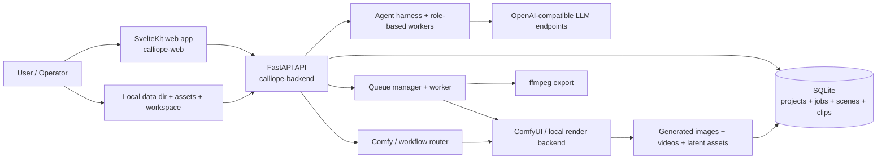
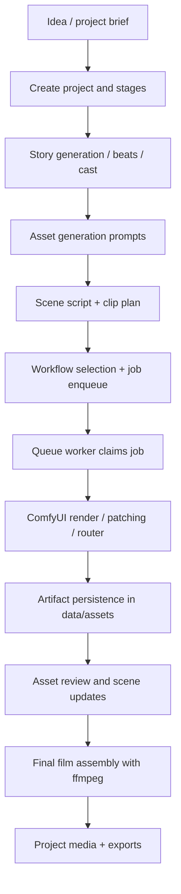
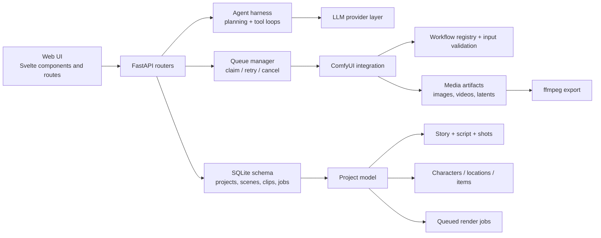

# Calliope — Project Architecture Summary

## Executive Summary

Calliope is a local-first AI story-to-video studio that turns a brief idea into a project, storyboard, generated assets, and rendered video clips. The system combines a Python FastAPI backend, a SvelteKit frontend, a SQLite project database, and a ComfyUI-based generation queue to move work from concept to final export. The backend owns project state, agent orchestration, workflow execution, and media export; the frontend is a browser UI for story creation, asset generation, script reviews, and video monitoring.

At the center of the architecture is a project model that stores scenes, clips, assets, workflows, jobs, and agent sessions. LLMs are used for story planning, generation prompts, script drafting, asset prompting, and continuity control, but all persistent state remains on disk in the local data directory rather than in a remote service. The result is a workflow that can run end-to-end on a single machine with optional OpenAI-compatible API endpoints and local ComfyUI installations.

## Architecture Overview



The runtime is split into a browser-facing frontend and a local backend service that owns all project state and worker execution. The browser does not directly talk to ComfyUI or the LLM; it uses HTTP APIs exposed by the backend, which in turn coordinates local filesystem access, queue state, and external services.

## Processing Pipeline



### End-to-end flow

1. A project is created from a story idea, genre, tone, and target duration. The backend persists the project and related entities in SQLite.
2. The story and script stages create beats, characters, locations, scenes, and clips. Work can be generated automatically by agent roles or edited manually by the operator.
3. Asset generation uses local ComfyUI workflows for image prompts, reference assets, and video renders. Workflow data and runtime settings are stored with the project and can be tuned per workflow.
4. Jobs are queued in the local database and processed by a worker that polls the queue, calls ComfyUI, and updates the job status as it succeeds or fails.
5. Final media is assembled by ffmpeg into the final film or export artifact while the project record still tracks the associated clips and outputs.

## Core Components

### Frontend — SvelteKit UI

The frontend lives under [calliope-web/src](../calliope-web/src) and presents the project lifecycle through pages such as project overview, story, assets, playground, canvas, and settings. It uses SvelteKit plus Svelte Query and a local data layer for service calls. The app is organized around views rather than a single monolithic page, and it relies on the backend for persistent state.

Key responsibilities:

- Project creation and navigation
- Story/beat editing and agent chat sessions
- Asset picker and generation workflow controls
- Script and video stage review
- Settings for LLM profiles, ComfyUI routing, and queues
- Canvas and networking views for generated artifacts

### Backend — FastAPI service

The server entry point is [calliope-backend/src/calliope/main.py](../calliope-backend/src/calliope/main.py). It creates the FastAPI application, mounts the API routers, manages lifecycle startup/shutdown, and serves the built frontend assets when present.

The API is split into routers under [calliope-backend/src/calliope/routers](../calliope-backend/src/calliope/routers):

- projects, story, scenes, shots, jobs, settings
- assets, library, workflows, canvas, playground
- agent, events

The backend is the system-of-record for:

- project metadata and story data
- agent sessions and event history
- queued generation work
- workflow definitions and runtime parameters
- saved media paths and final export records

### Agent harness

The agent layer lives under [calliope-backend/src/calliope/agent](../calliope-backend/src/calliope/agent). It includes:

- a role-based harness with planner and sub-agent orchestration
- tool registries and session memory
- LLM client abstraction and profile selection
- prompt templates and safety constraints
- plugins for workspace, story, script, canvas, memory, and Comfy actions

The orchestration pattern is important: a simple request may run in a single loop, while a multi-step task can fan out into a planner plus sub-agents that each operate within a scoped tool set. This is designed to keep the AI focused on the active project and avoid cross-project leakage.

### Queue and job execution

The queue subsystem is in [calliope-backend/src/calliope/queue](../calliope-backend/src/calliope/queue). It maintains the SQLite-backed job table, claims pending work, marks jobs as running/done/failed, and supports retry and cancellation semantics. The queue is the bridge from “work is requested” to “ComfyUI render is running.”

### ComfyUI integration and workflow layer

The Comfy integration is under [calliope-backend/src/calliope/comfyui](../calliope-backend/src/calliope/comfyui). It covers:

- workflow registration and schema discovery
- node/value patching for generation jobs
- Comfy SDK and router support
- prompt smart-fill and runtime validation
- job execution payload assembly

This layer is central to the platform’s promise: operators can load existing workflows, map input values, and let the system run them while preserving local control.

## Component Relationships



## Data Model and Persistence

The system persists most structured domain data in SQLite, including:

- projects
- story_beats
- characters, locations, items
- scenes and scene-to-entity links
- clips, workflows, jobs
- agent sessions and events
- canvas state and nodes

The schema in [calliope-backend/src/calliope/db.py](../calliope-backend/src/calliope/db.py) is the architectural core. It treats the project as a graph of related entities rather than a single “script” blob. A scene can contain multiple clips, and each clip can carry its own timing, workflow, and generated media references.

This design strongly supports iterative generation and re-rendering without losing the narrative structure of the project. It also makes it possible to reconstruct the flow from project state alone, which is crucial for a local-only authoring app.

## API Contracts and Integration Points

The backend exposes a REST API rooted under `/api` with route groups such as:

- `/api/projects` for project CRUD and story operations
- `/api/settings` for config, profiles, and agent configuration
- `/api/workflows` for workflow definitions and runtime metadata
- `/api/jobs` for queue lifecycle and status polling
- `/api/agent` for agent conversation sessions
- `/api/events` for live updates and event broadcasting

The strongest integration dependencies are external and local:

- OpenAI-compatible LLM endpoints via HTTP JSON APIs
- ComfyUI via the Comfy SDK / local HTTP surface
- ffmpeg for final media export
- local filesystem for saved assets, project data, and workspace scratch files

## Deployment and Runtime

### Local deployment model

The project is designed to run on a local machine with:

- Python 3.11+
- Node.js 18+
- ffmpeg on PATH
- OpenAI-compatible LLM endpoint (local or remote)
- ComfyUI instance with model support installed

### Service layout

- Backend: `calliope-backend` with a FastAPI app
- Frontend: `calliope-web` with SvelteKit and Vite
- User data: `calliope_config.json` plus a local `data/` folder for SQLite and media
- Agent workspace: a project-scoped sandbox under the configured data directory

### Operational characteristics

- No cloud-only persistence is required for core work
- LLMs are configurable per profile and can be assigned to specific agent roles
- Queue work can be retried, deferred, or cancelled
- App startup migrates the SQLite schema and rebases stale asset paths if necessary

## Extension Patterns

The architecture supports extension in a few clear places:

1. Add new workflows in the workflow registry and store them in SQLite.
2. Add new agent tools or plugins under the harness plugin directory to widen what the planner/sub-agents can do.
3. Add new API routes under the routers package and connect them to project services or state models.
4. Add new job kinds and rendering logic by extending the queue worker and Comfy integration path.
5. Add UI views in the Svelte frontend to expose new stages without changing the data model unnecessarily.

The most important rule is to keep the UI stateless from a persistence standpoint: the backend remains the single source of truth, and the browser only reflects current state.

## Rules and Anti-Patterns

The project’s engineering decisions encourage a few important guardrails:

- Keep project state local and explicit; do not assume a remote database is required.
- Do not let the agent operate outside the active project and session workspace.
- Avoid inventing content that was not surfaced by tool results or persisted records.
- Treat the queue as the source of command execution rather than letting UI actions directly trigger long-running work.
- Preserve asset paths and media lifecycle as part of the project rather than leaving them in ephemeral directories.
- Keep workflow behavior explicit: strict mode, schema validation, and runtime budget checks reduce accidental prompt leakage.

## Dependency Summary

| Area | Primary technologies |
| --- | --- |
| Backend | Python, FastAPI, Pydantic, SQLite |
| Frontend | Svelte, SvelteKit, TypeScript, Vite |
| UI data layer | TanStack Svelte Query |
| Generation | ComfyUI, Comfy SDK, optional Comfy Router |
| LLM access | OpenAI-compatible chat API endpoints |
| Media export | ffmpeg |
| Validation | pytest, ruff |

## Code Structure

```text
Calliope/
├── README.md
├── calliope-backend/
│   ├── src/calliope/
│   │   ├── agent/
│   │   ├── comfyui/
│   │   ├── queue/
│   │   ├── routers/
│   │   ├── authoring/
│   │   ├── events/
│   │   ├── export/
│   │   ├── models/
│   │   ├── config.py
│   │   ├── db.py
│   │   ├── main.py
│   │   └── __init__.py
│   ├── tests/
│   ├── pyproject.toml
│   └── requirements.txt
├── calliope-web/
│   ├── src/
│   ├── package.json
│   ├── svelte.config.js
│   └── vite.config.ts
├── docs/
│   ├── changelogs/
│   ├── features/
│   └── diagrams/
├── example_ComfyUI_workflows/
├── scripts/
├── setup.sh
├── start.sh
├── stop.sh
└── status.sh
```

## High-Level Diagram Files

The repository includes editable diagram sources under [docs/diagrams](./diagrams):

- [high-level-architecture.drawio](./diagrams/high-level-architecture.drawio)
- [processing-pipeline.drawio](./diagrams/processing-pipeline.drawio)
- [component-relationships.drawio](./diagrams/component-relationships.drawio)

This summary intentionally does not generate a DOCX file. The diagram sources are kept in a format that can be opened directly in draw.io and also rendered as Mermaid in GitHub-friendly Markdown.
